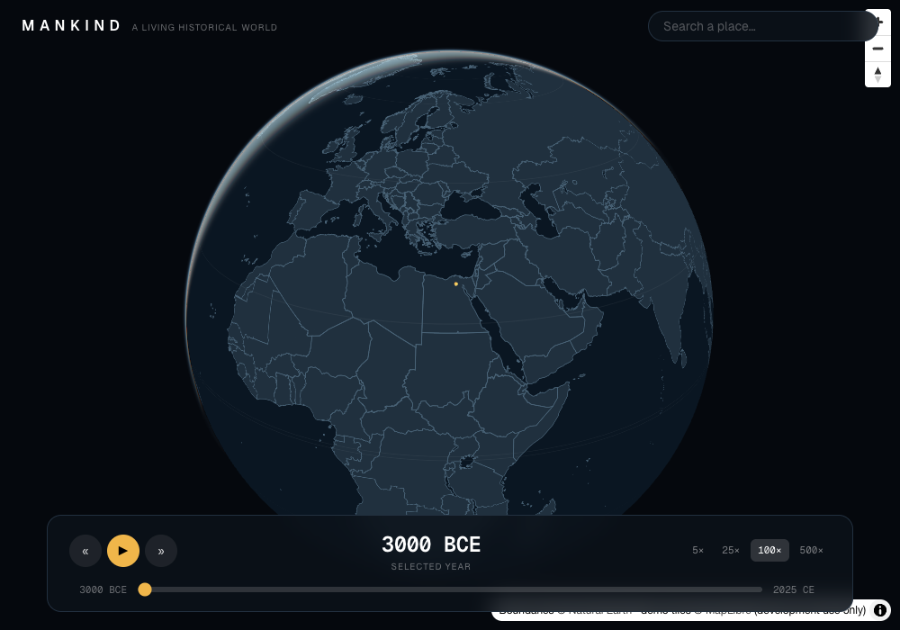
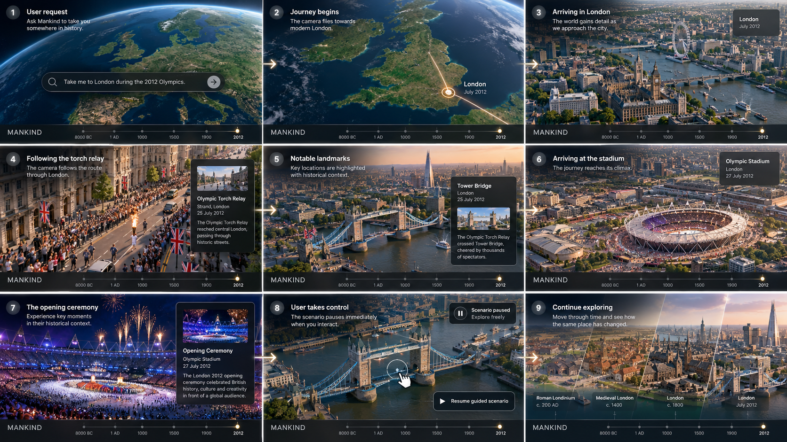

# Mankind — a living historical world

A web-based historical exploration experience: a beautiful, stylized 3D globe
you can rotate, zoom, and move through time on, from **3000 BCE to the present**.

This repository contains the Phase 1 rendering foundation and **Phase 2, Step 1**
local Natural Earth physical geography. The rendering foundation combines:

1. An interactive **MapLibre globe** with real geographic context.
2. A **historical timeline** using a correct BCE/CE calendar model.
3. **Three.js geometry anchored to real coordinates**, rendered inside
   MapLibre's own WebGL pipeline and staying aligned as the globe moves.

There is no backend, database, AI, or historical dataset yet — those are later
phases. The timeline changes application state only.



## Vision

The goal: ask Mankind to take you somewhere in history ("Take me to London
during the 2012 Olympics") and be flown there in a guided, cinematic scenario
with historical context — pausing whenever you take control, and letting you
move through time to see how the same place changed. See
**[docs/vision.md](docs/vision.md)** for the full storyboard, principles, and
gap analysis.



---

## Getting started

Requirements: **Node 20+** and **pnpm** (`packageManager` pins pnpm 11).

```bash
pnpm install        # install dependencies
pnpm dev            # start the dev server → http://localhost:3000
```

Other commands:

```bash
pnpm build          # production build
pnpm start          # serve the production build
pnpm typecheck      # tsc --noEmit (strict)
pnpm lint           # eslint
pnpm sync-worker    # (re)copy MapLibre's worker into public/ (also runs on predev/prebuild)
```

> **Note on the MapLibre worker.** `pnpm dev`/`pnpm build` first run
> `scripts/sync-maplibre-worker.mjs`, which copies MapLibre's web worker into
> `public/maplibre/`. This is required because MapLibre resolves its worker from
> a runtime-computed filename that Turbopack cannot bundle; we serve it as a
> static same-origin asset instead. See "Known limitations" below. The copied
> file is git-ignored and regenerated from the installed package version.

---

## What you can do in Phase 1

- **Rotate, pan, and zoom** the globe (drag to rotate, right-drag/ctrl-drag to
  tilt & spin, scroll to zoom; nav control top-right).
- **Scrub through time** with the bottom timeline, **play/pause** automatic
  progression, step ±100 years, and choose a **playback speed** (5–500 yrs/sec).
- See a **stylized 3D marker** (a beacon on a tapered tower) anchored at the
  Giza plateau (≈31.13 °E, 29.98 °N). It stays locked to that coordinate as you
  rotate and zoom, and is correctly **hidden when it rotates to the far side**
  of the globe.

---

## Architecture

Rendering code is kept separate from interface components, and runtime WebGL
objects are kept out of serializable state.

```
app/
  layout.tsx            Root layout, fonts, metadata (server component)
  page.tsx              Mounts the client Explorer shell
  globals.css           Tailwind v4 + dark theme tokens

components/             Interface (client)
  Explorer.tsx          Shell: layout, WebGL gate, status overlays, playback loop
  GlobeView.tsx         MapLibre lifecycle; mounts the Three.js layer (ssr:false)
  Timeline.tsx          Scrub / play-pause / step / speed
  TopBar.tsx            Wordmark + placeholder search
  Overlays.tsx          Loading / error / WebGL-unavailable states

map/                    Rendering modules
  mapStyle.ts           Painterly dark style + data source + base camera
  threeTestLayer.ts     Three.js ⇄ MapLibre custom layer (the integration)
  webglSupport.ts       WebGL 2 capability probe

lib/                    Pure utilities (no React/renderer deps)
  historicalDate.ts     Astronomical-year ↔ BCE/CE conversion & bounds
  geo.ts                Globe unit-sphere math, local frames, matrix lerp

state/
  explorationStore.ts   Zustand store: year, playback, speed, view (serializable)

scripts/
  sync-maplibre-worker.mjs   Copies MapLibre's worker into public/
```

### Historical dates

`lib/historicalDate.ts` is the single source of truth for years and uses
**astronomical year numbering** (there is a year zero), so arithmetic across the
BCE/CE boundary is continuous and off-by-one-free:

| astronomical | label      |
| -----------: | ---------- |
|       `-2999`| `3000 BCE` |
|          `-1`| `2 BCE`    |
|           `0`| `1 BCE`    |
|           `1`| `1 CE`     |
|        `2025`| `2025 CE`  |

JavaScript `Date` is deliberately **not** used for historical years — it can't
represent the pre-1 CE calendar we need.

### The Three.js ⇄ MapLibre integration (the important part)

`map/threeTestLayer.ts` is a MapLibre **custom layer** that renders Three.js
geometry into **MapLibre's own WebGL2 context and canvas** — no second canvas,
no independent animation loop. MapLibre calls its `render()` each frame while
the map moves; we do not call `triggerRepaint()` for the static marker, so there
is no perpetual render loop.

Anchoring respects MapLibre's globe projection exactly. Each frame MapLibre
provides a globe `mainMatrix` (projects a **unit sphere** to clip space), a
mercator `fallbackMatrix`, and a `projectionTransition` ∈ [0,1] that it uses to
cross-fade globe→mercator as you zoom in. We mirror that: we precompute a model
matrix for the marker on the unit sphere and at its mercator coordinate, form
the two full MVP matrices, and interpolate them by the transition. Because
matrix·vector is linear, `lerp(A,B,t)·p ≡ lerp(A·p, B·p, t)`, so the
interpolated matrix reproduces MapLibre's per-vertex blend and is exact at both
endpoints. Far-side geometry is culled using MapLibre's globe clipping-plane
data. The unit-sphere convention and `GLOBE_RADIUS` are taken directly from
MapLibre's globe vertex shader.

Lifecycle is handled safely: the layer creates one `THREE.WebGLRenderer` over
the shared context in `onAdd`, resets GL state each frame (`resetState()` +
`clearDepth()`), and disposes all geometries/materials and the renderer in
`onRemove`. `GlobeView` removes the map on unmount.

---

## Map data, styling and licensing

The globe uses locally hosted **Natural Earth v5.1.2 physical geography**:
50m land, natural lakes and rivers for global/continental views (2.46 MB GeoJSON,
about 850 KB gzip), plus **10m land for regional views**. Visible regional vector
tiles start loading at zoom 4 and fade in across zooms 4.5–5.5 once loaded, with
a 300 ms transition for camera jumps. The complete regional tileset is 2.94 MB;
only nearby tiles are requested. Both resolutions derive coastlines from their
own land polygons; regional ocean masks remove the old shoreline during the fade.
No dependencies were added. There are no political layers,
labels, sprite requests or font requests from the map style. Elevation now uses remote Mapterhorn DEM tiles.

The dark ocean (`#0a1622`), land (`#223240`), globe projection, atmosphere and
camera defaults are preserved. The existing intentional coordinate overlay now
uses 30° spacing and fades away by zoom 5. The palette remains centralised in
`map/mapStyle.ts`; physical sources are independent of timeline state.

Natural Earth is public domain; attribution is optional. The globe voluntarily
credits “Made with Natural Earth (public domain)”. See the
[verified terms](https://www.naturalearthdata.com/about/terms-of-use/) and the
[vendored data notes](public/geo/natural-earth-v5.1.2/README.md) for provenance,
checksums, transformations, resolution tradeoffs and reproducible rebuild steps.
MapLibre demonstration tiles and their attribution have been removed.

The existing Phase 1 Three.js marker is retained; this geography step adds no
renderer or dependency. Mapterhorn elevation is implemented in Phase 2, Step 2.

---

## Geography checks

- `pnpm typecheck` — TypeScript strict.
- `pnpm lint` — ESLint.
- `pnpm build` — production build; `/` prerenders as static.
- `node scripts/check-geography.mjs` — validates the actual style with MapLibre's
  installed validator, checks local Natural Earth sources and Mapterhorn DEM configuration, geometry types,
  coordinate ranges, closed polygon rings, data budget and 30° grid/fade. It also
  decodes all regional tiles, checks shared land/coast vertices, complementary
  masks and triangulation, and exercises the loading gate, zoom fade and cleanup.

The geography checks also verify the terrain source/encoding, the 1× default,
and physical versus displayed height separation at every supported exaggeration.

---

## Known limitations

- **Generalised geography.** Natural Earth 50m supports global/continental views
  and 10m improves regional coastlines, including France. Regional tiles overzoom
  above z4 while retaining 10m source detail; this is not local navigation.
  Higher-resolution OSM coastlines are deferred until settlement-scale detail
  is required. Geography represents a
  static physical baseline, not historically reconstructed coastlines or rivers.
- **Exaggerated marker scale.** The test marker is ~150 km tall — deliberately
  oversized so it reads as a beacon from orbital zoom. It is a geometry/anchoring
  proof, not final art; at street-level zoom it dominates the view. Real objects
  in later phases will use realistic, zoom-aware scales.
- **Projection blend is per-object, not per-vertex.** The globe↔mercator MVP
  blend is applied to the whole marker. For a compact object this is
  imperceptible and exact at both endpoints; a large object spanning the seam
  during the transition could differ slightly from MapLibre's per-vertex blend.
  A fully per-vertex-correct path would render through MapLibre's injected
  `projectTile` shader prelude (raw GLSL) instead of Three.js materials.
- **MapLibre worker is copied into `public/`.** MapLibre computes its worker URL
  from a runtime filename Turbopack can't bundle; the `predev`/`prebuild` copy
  step and `setWorkerUrl` work around this. If you change the maplibre-gl
  version, the copy refreshes automatically on the next build.
- **One-way camera sync.** User navigation is mirrored into shared state on
  `moveend`; state does not drive the camera back (avoids feedback loops). Full
  two-way sync is a later concern.

---

## Mapterhorn elevation (Phase 2, Step 2)

MapLibre's built-in `raster-dem` terrain uses
`https://tiles.mapterhorn.com/{z}/{x}/{y}.webp`, **Terrarium encoding**, 512 px,
XYZ tiles. See [Mapterhorn data access](https://mapterhorn.com/data-access/) and
[data attribution](https://mapterhorn.com/attribution). Requests stop at native
z12, the globally available archive; MapLibre overzooms automatically beyond it.
Higher native zooms have partial coverage and are intentionally not requested.
No additional dependencies, terrain meshes, or custom LOD were introduced.

The default is **1.0×**. The **Debug tools** panel opens by default at top left; its **Terrain** section lets you choose 1.0×,
1.5×, 2.0× or 2.5×. It changes one constant exaggeration through `setTerrain`;
it never varies with zoom or timeline year. **Hillshade** is on by default and
loads its own DEM source; the checkbox turns it off. It is only
a relief inspection aid; the Step 3 landscape styling remains deferred.

Hillshade is composited **after regional land and before the regional ocean
mask**, with coastline outlines, rivers and lakes above it. The mask and land
use the same Natural Earth 10m rings. Hillshade is restricted to z6+ where
regional geography is fully active: it waits for loaded coastal tiles and the
300 ms opacity transition, and hides while new coastal tiles load. Below z6,
there is only an ocean background (no matching global polygon mask), so the
inspection shading is suppressed. This gate affects shading only; Mapterhorn
physical terrain and its single exaggeration value remain enabled at all zooms.
Disabling Hillshade removes its layer, DEM source and event listeners.

A polygon filter cannot clip a raster DEM hillshade layer to an unrelated
vector source. Reusing the existing opaque ocean fill avoids custom stencil
rendering, new mask datasets and new dependencies. Moving hillshade alone below
the old translucent ocean fade would still leak through during loading/fades;
the readiness gate prevents that. `node scripts/check-hillshade.mjs` checks the
compositing order, loading/fade gate, zoom-out cancellation and cleanup.
The check also decodes the actual coastal masks around Spain/Biscay, Corsica
and Greece/Crete and verifies that sea samples are covered while land samples
remain exposed. These automated checks pass, as do TypeScript, lint, geography
validation and the Webpack production build. Live hillshade-on/off comparisons
for this refinement remain pending: foreground Chrome interactions interrupted
browser automation, and the browser was still in active use. The earlier
terrain visual checks above predate this mask refinement.


DEM errors show a nonfatal warning inside this panel. Navigation and Natural
Earth remain usable with parent/zero-height fallback managed by MapLibre.
**Retry elevation tiles** refreshes the DEM requests. The warning records a
failure until explicitly retried, even if subsequent navigation loads new tiles.

`map/terrain.ts` exposes `queryTerrainHeights(map, location)` for future object
placement: `elevationMeters` removes MapLibre 6's exaggeration, while
`displayMeters` matches the rendered surface. It samples the currently loaded
DEM/mesh, not an independent authoritative elevation service. MapLibre can
return zero for unloaded locations; resample after source data arrives.
The existing Three.js proof marker is unchanged and still anchored at sea level.

Live Chrome checks on 26 October 2026 tested all four exaggerations at z11,
with a 60° pitched camera and changing bearings:

| Region / sample centre (longitude, latitude) | Peak-area sample at 1× | Lower sample |
| --- | ---: | ---: |
| Alps / Matterhorn (7.6586, 45.9763) | 4,369 m | 1,611 m |
| Himalayas / Everest (86.9250, 27.9881) | 8,673 m | 4,922 m |
| Highlands / Ben Nevis (-5.0036, 56.7969) | 1,329 m | 11 m |
| Mediterranean / Corsica (8.9450, 42.3820) | 2,349 m | 0 m offshore |

All 16 combinations reached loaded state without source errors. Coastal pan/zoom
checks at z8, z10 and z13 and globe rotations at z2.1 also completed. One
coastal DEM request returned 404; MapLibre silently handles missing tiles using
parent/child fallback. A deliberate invalid-image DEM response produced the
nonfatal panel warning, kept the map usable, and recovered through Retry.
Timeline play/pause advanced the year successfully; search remains the existing
disabled placeholder. Displayed
heights scaled with exaggeration; raw samples can vary slightly as camera
coverage selects a different DEM/mesh resolution. Diagnostic visual checks
showed raised ridges and valleys in all four regions, including Highlands at
z10. These are sampled elevations, not claims of exact summit heights.

Known rendering limits: Natural Earth coastlines and water polygons remain
generalised and are draped onto the DEM. At close zoom they can cross slopes
rather than coincide with the DEM's exact sea-level contour; exaggerated terrain
makes that mismatch more visible. Water polygons are not flattened. Faint tile tint seams are visible at globe scale. Fine mesh
faceting becomes apparent at high exaggeration. Uniform land fill without
hillshade makes interior relief difficult to see. MapLibre emits
`calculateFogMatrix is not supported on globe projection` with terrain enabled;
the existing sky/atmosphere configuration is retained. No performance benchmark
has been recorded; terrain necessarily adds DEM requests and GPU work.

Final validation: `pnpm typecheck`, `pnpm lint`,
`node scripts/check-geography.mjs` and `pnpm exec next build --webpack` pass.
An earlier `pnpm build` passed; a subsequent Turbopack rebuild failed on local
CSS worker port binding permissions (including an escalated retry), so the
final production build was verified with Webpack. No bundler configuration
was changed.

## Natural biomes

Biome colour comes from offline-generated OpenLandMap PNV raster tiles, loaded
by MapLibre at runtime from a configurable external URL. Generated rasters and
tiles are ignored by Git and stay outside the Next.js build; the production
bundle contains no raster bytes and has no default tile service.

- **[docs/global-biomes.md](docs/global-biomes.md) — current.** Step 4: the
  worldwide `pnv-v4-global` pyramid. Generation commands, dateline and polar
  handling, the measured tile-format and maximum-zoom decisions, storage and
  runtime measurements, the Cloudflare R2 workflow, attribution and limitations.
- [docs/terrain-refinement.md](docs/terrain-refinement.md) — Step 3B: the
  `pnv-v4` palette, materials and hillshading this run reuses unchanged, with
  matched before-and-after captures and rollback.
- [docs/biomes.md](docs/biomes.md) — Step 3: the original `pnv-v2` regional
  baseline, source and licence verification, and hosting architecture.

```sh
.biome-venv/bin/python scripts/biomes/fetch.py --global --dem-zoom 6 --jobs 10
cd scripts/biomes && ../../.biome-venv/bin/python build.py --global \
    --format webp --maxzoom 7 --workers 8 --output ../../.biome-data/tiles/pnv-v4-global
.biome-venv/bin/python scripts/biomes/check.py .biome-data/tiles/pnv-v4-global
pnpm dev   # also serves the tiles on 127.0.0.1:8766
```


## Roman GLB integration (Phase 3)

Use **Debug tools → Visit Roman test** to see the villa, temple and two-tier
aqueduct together near Giza. This is an integration fixture, with no historical
claim about the location. The Roman models checkbox releases the test assets.
See [docs/roman-assets.md](docs/roman-assets.md) for registration, placement,
source/licence records, resource ownership, terrain limits and validation.
This supersedes the Phase 1 notes above about clearing depth and anchoring the
beacon at sea level: the shared layer now preserves terrain depth, samples the
displayed ground and hides the oversized beacon at zoom 12 and above.

### Reusable Roman settlement

**Debug tools → Visit settlement** assembles seven existing Roman models near
Rome from an origin plus local metre offsets, with a terrain-following road,
paths and level foundations. **Relocate nearby** reuses the same layout at a
second origin; the settlement checkbox unloads it. The original Giza asset test
remains available. See [docs/settlement-layout.md](docs/settlement-layout.md) for
the definition/assembler API, DEM waiting/retention policy, validation and limits.

### Settlement environment and visual polish

The settlement now includes olive/cypress trees, shrubs, rocks, grass and Roman
props, with instancing, warm sunlight and terrain-shaped shadow reception.
The terrain adapter accepts confirmed zero elevations, junctions use one joined
street mesh, and entrance paths meet their foundations. See
[docs/settlement-environment.md](docs/settlement-environment.md) for assets,
provenance, shadow integration, validation and limitations.


### Phase 3 integration handoff

See [Phase 3 completion and Phase 4 contract](docs/phase3-completion.md) for the
implementation inventory, ownership fixes, browser captures, resource measurements
and known limits. Run `node scripts/check-phase3.mjs` for the 18-command integration
gate. Phase 4 Step 1 remains a schema proposal; no historical database or AI director
was implemented in this milestone.
