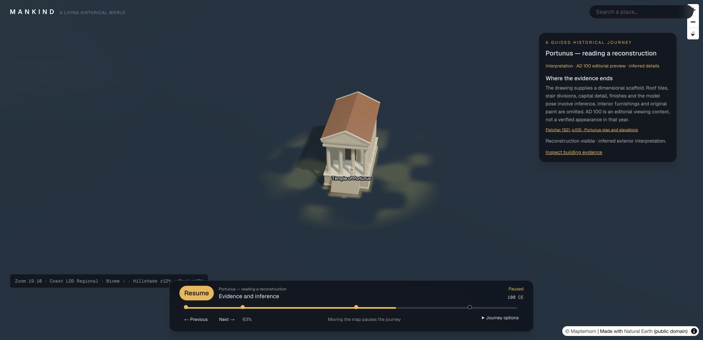

# Phase 4 acceptance and handoff

Phase 4 delivers a bounded working pilot: one sourced, evidence-labelled Portunus
journey, one reusable catalogue-pinned building, inspection, explicit interpretation
selection, interruption/exploration/resume, and missing-content handling. This is
not a general historical reconstruction service. AD 100 remains an editorial
preview and inferred dimensions, finishes, pose and location remain labelled.

## Acceptance and final integration fix

The acceptance review found a production-only wiring defect: the shared historical
session and inspector were created inside the development-only Debug panel. The
production app could therefore never initialise the journey. Session/overlay
ownership and the inspector now mount through `HistoricalWorldSession` alongside
the map/player in `GlobeView`, in every build. Debug dataset controls only consume
that existing session. No second dataset owner, cache, renderer or animation loop
was added.

A second production defect was visual: the project configured Tailwind only as a
Turbopack loader. A webpack build could exit successfully while emitting raw
Tailwind directives and leaving the map/panels unstyled. The project now uses the
installed Next.js guide's shared `@tailwindcss/postcss` setup and removes the
superseded loader/rule. Both bundlers compile styles. The integration gate now
checks emitted page-linked CSS for compiled layout/panel utilities and rejects
raw Tailwind directives. The guard failed against the original production output
before the fix.

The repeatable integration check, `scripts/check-phase4-acceptance.mjs`, drives the
actual player → historical session → scene resolver → streamer → GLB cache →
`SettlementScene` pipeline. It uses a simulated map and confirmed flat DEM with
the real model bytes, rather than a browser or GPU. It verifies:

- An overview with no model requests, then the exact catalogue-bound temple.
- Ten repeated visits/date revocations/restores/exits with one detail slot and one
  live model lease while visible, zero leases and scheduled player frames on exit.
- Three full near/far camera replays ending on the visible temple; unchanged
  date/model across beats retaining the same scene, warm cache reuse
  without another source parse, and bounded source/surface caches.
- A late dataset request not replacing an adopted journey; a late GLB completion
  after exit not resurrecting the scene or retaining a lease.
- A missing model hiding its coarse historical proxy; restart retrying the same
  file; full layer removal clearing warm sources and surface maps, idempotently.

The domain suite additionally covers schema/reference/date/geometry validation,
catalogue review/hash/rights guards, exact pins, source attribution, outside dates,
mandatory failures, material preservation, terrain uncertainty and fixture
regressions. Historical source truth and expert archaeological accuracy are not
certified by these software checks.

## Reproduce and run

```sh
pnpm dev
node scripts/check-phase4-acceptance.mjs docs/previews/phase4-final
node scripts/check-phase3.mjs docs/previews/phase4-final
pnpm build
pnpm start
```

The integration gate retains its historical filename and discovers all domain
checks, including Phase 4 acceptance. Logs are in
[regression.json](previews/phase4-final/regression.json). All **30 final commands passed** on 30 October 2026. The gate comprises
30 commands: 26 domain checks, TypeScript, ESLint, the default Turbopack production
build and the emitted-style verification. The webpack build is also checked separately.

The normal `pnpm build` (Turbopack) initially failed with the prior custom CSS
loader's process/port error; webpack compiled but produced incomplete styles.
After replacing that loader with the shared PostCSS integration, the normal
Turbopack build succeeds. [The successful build log](previews/phase4-final/turbopack-build.log)
and [earlier failure](previews/phase4-final/turbopack-before-css-fix.log) preserve the
before/after evidence. The default build command was retained. The separately
verified webpack path is `pnpm exec next build --webpack` followed by
`node scripts/verify-production-styles.mjs`.

## Browser acceptance

Desktop Chrome uses the actual running app, visible controls and DOM-rendered
diagnostics. A complete uninterrupted 35-second run was observed from the start
card to Completed, with source cards, the specific building and AD 100 labels.
The 390 × 844 CSS-pixel viewport check confirms readable/scrollable evidence,
accessible close/navigation controls, no horizontal document overflow, and focus
return to **Inspect building evidence**. The viewport was reset afterwards. This
is responsive desktop-browser testing, not physical touch or mobile GPU acceptance.

Step 9's [browser evidence](portunus-journey.md) also records an actual missing GLB
and restored retry, date revocation/restoration, map interruption, free exploration,
exit and London compatibility. The final production walkthrough is recorded in
`docs/previews/phase4-final/`; it specifically checks the journey and source/rights
inspector with the development panel absent. A repeated full production replay ended at zoom
19.10 with both **Completed** and **Reconstruction visible**. The corrected production map filled
1728 × 837 CSS pixels. At 390 × 844, the inspector stayed within the viewport,
the document had no horizontal overflow, and closing returned focus to the evidence
button. See [production-acceptance.json](previews/phase4-final/production-acceptance.json).



One earlier post-completion observation showed a distant camera. This did not
reproduce in the subsequent uninterrupted replay, which ended on the temple;
the exact cause was not established. Completion allows subsequent free navigation.
The terminal acceptance therefore checks actual camera/model state alongside the
completion label. A supplementary near/far terminal replay check is saved in
`terminal-replay-check.log`; no camera implementation change was made.

Production biome tiles require `NEXT_PUBLIC_BIOME_TILE_URL` to be set to a reachable
host at build time. Without it, the production app shows the dark geographic
baseline rather than the development localhost biome layer; it still renders the
reconstruction. This test did not create or publish a production tile host.

## Performance and resource evidence

[Pipeline measurements](previews/phase4-final/pipeline-performance.json) record
five cold and five warm Node visits using the actual GLB, synthetic flat DEM and
simulated map. Cold scene-ready wall times were **209–248 ms** (median 219 ms); warm times were
**2.7–7.4 ms** (median 5.9 ms), with no new source requests in the warm samples. These are small
local CPU samples, not a speed guarantee or a browser/GPU benchmark. Scene-ready
wall starts at scene construction. The separate settle measurement includes the
230 ms test dwell and must not be confused with scene-ready time.

Development Chrome at a 3456 × 1674 device canvas recorded one model source
request, one lease, about 3.1 MiB estimated source storage and about 2.75 MiB of
cached surface arrays. First scene-ready wall was **550 ms**, excluding camera
travel, streaming dwell and earlier page startup. Active frame intervals over the
last 240 samples were approximately **10 ms median / 11–13 ms p95**. These visible
diagnostics are rounded, exclude gaps ≥250 ms and exclude MapLibre draws; they do
not quantify long-stall frequency, total GPU memory or production GPU timings.
Three recorded 15 submissions / 171,536 submitted triangles including shadow
passes; this is different from the source mesh's 84,294 triangles. The two counts
must not be equated.

Ordinary exit retains bounded warm cache resources intentionally. Full map/layer
teardown cleared both caches to zero in the integrated test. No heap-leak or
physical-device performance certification is claimed.

## Handoff boundaries

| Area | Delivered | Remaining boundary |
| --- | --- | --- |
| Evidence and geography | Sourced places/events/routes, dated selection, reference/extent pilots and inspector | A visitor anchor or property extent is not a surveyed building plan; source coverage is small |
| Reconstruction | Specific authored Portunus exterior with sources, feature certainty and omitted details | Interpretive historic drawing; no measured restitution, interior, people or ancient neighbourhood |
| Catalogue | Persistent immutable content versions, append-only reviews, hash/rights checks, exact pins | Compiled local store; no authenticated service, live administration or automatic rights verification |
| Scene plans | Explicit requested scene/layout through one existing streaming slot | One registered journey dataset and at most one explicit interpretation per plan; no nearest-era substitution |
| Roads/navigation | Existing geometry and explicit unsupported-layout guards | General arbitrary historical road navigation and broad wall-plan ingestion remain outstanding |
| Presentation | Sourced Portunus journey, retained London journey, inspector and fallback/retry | Close geography is sparse; regional silhouettes are coarse and LOD replacement is discrete |
| Runtime | Single map/date authority, shared session, interruptible player and bounded caches | Remote DEM/biome resources can fail; production requires reachable/configured tile services |
| Tooling | Domain checks, typecheck/lint, webpack production build and browser acceptance | Physical touch and production GPU profiling remain untested |

Model source and rights rationale are in [the reconstruction record](portunus-reconstruction.md)
and `public/assets/reconstructions/portunus/PROVENANCE.md`. The model introduces
no new public licence. Menander remains a draft without a model; Housesteads is
sourced map context. Missing content is reported rather than filled with a generic
Roman asset.

## Phase 5 starting boundary

The next recommended slice is a structured scenario-request and content-gap plan:
normalise place/date/intent, resolve exact reusable catalogue candidates, and
return the scenes that can be shown plus explicit missing-evidence/asset tasks.
Keep its output serialisable and run it through the existing validators/resolver.
An AI must not mutate MapLibre/Three directly or silently promote a downloaded
model to usable.

Subsequent research/acquisition can search for sources and candidate assets,
record origin/rights/feature uncertainty, ingest a new immutable draft version,
and use the same review and rendering checks before reuse. No AI API, automatic
research/downloading, model generation service, database or public publishing
system was implemented in Phase 4. Provider selection, costs and research policy
remain decisions for that work.
