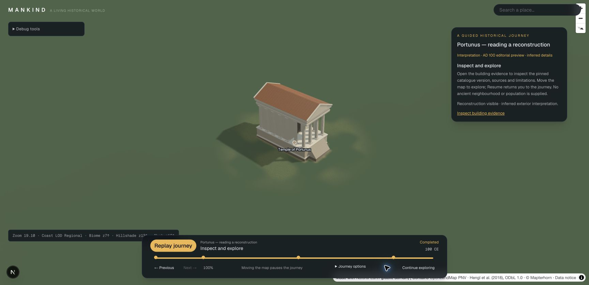

# Portunus sourced journey — Phase 4 Step 9

**Portunus — reading a reconstruction** is the default guided journey. It reuses
`catalogue:portunus-exterior@1` through the existing historical scene plan,
registry, cache and terrain renderer. London 2012 remains available in the
journey selector when playback is idle.

Choose **Start Portunus interpretation**. Starting explicitly selects this
interpretation for the journey; the start card and every stop retain the
**AD 100 editorial preview / inferred details** label. This is a 35-second camera
and evidence tour of one temple, not a reconstructed ancient neighbourhood.

| Stop | Experience | Content |
| --- | --- | --- |
| Locate the temple | Geographic approach | Official identity/location sources; no model requested |
| Read the exterior | Approach, then hold on the building | High podium, entrance steps and four-column front; catalogue-pinned exterior |
| Evidence and inference | Orbit around the same building | Historic drawing versus inferred details, finish and pose |
| Inspect and explore | Hold and hand control to the user | Source/rights/version inspector, exploration and replay |

The narrative paraphrases the already reviewed [Step 8 sources](portunus-reconstruction.md).
The location remains an approximate visitor anchor. AD 100 is editorial rather
than an exact attested state; no additional archaeological claims or asset rights
are introduced. Camera paths are presentation choices, not historical routes.

## Ownership and scene resolution

`HistoricalJourneyScenes` maps the scenario's declared historical dataset and
scene/layout IDs to a registered bundled world. It does not fetch citations,
search for assets, select a nearest match or float to a newer catalogue version.
The overview keeps geographic context only. Subsequent stops explicitly select
`layout:portunus-classical` and request `scene:portunus-exterior`. Normal catalogue,
phase, rights, category and evidence guards still apply. The dataset session
limits streamed descriptors to ready scenes requested by the current beat.

There is one shared historical dataset session, one scene/cache owner and one
scenario animation loop. The inspector and manual dataset controls use that same
session. Journey presentation cancels stale dataset requests; manual dataset
replacement exits the journey. Controls display the actual active dataset/date.

The player resolves scene plans after setting its intended date on entry, jump,
action change and resume. A pure metadata resolution does not assert that a GLB
has loaded. The journey panel separately reports approach, loading/terrain wait,
visible interpretation or model failure using the renderer's current status.

## Interrupt, explore, resume and exit

- Map gestures pause playback before navigation. Source links and opening debug
  controls are inert; **Inspect building evidence** pauses and opens the shared
  catalogue/source inspector.
- **Explore freely** retains the current reconstruction and progress. A manual
  date change revokes the preview. Explicitly showing/hiding an interpretation
  while exploring remains possible.
- **Resume** restores the saved journey date, scene plan and pose, then continues
  the same action. Resume does not silently select a different catalogue version.
- Beat jumps resolve their own content; replay starts at geographic context and
  releases the old detailed scene. Completion keeps the final scene available
  for exploration. Exit, replacement and disposal release journey-owned content.
  A manual dataset that the journey never adopted is not released by an idle
  player stop.

## Missing content

Unresolved optional scene plans or blocked catalogue/date bindings produce an
explicit geographic-context warning; the journey's map and source cards continue.
A missing required scene stops preparation with an error. No substitute building
is selected.

A model-fetch failure shows **The reconstruction could not load** and **Retry
journey**. For a failed historical detail load with no buildings, its coarse
regional proxy is hidden and the marker remains available. Retry returns through
the overview, recreates the detailed scene and retries the existing model URL.
Model errors do not masquerade as successful metadata resolution.

## Validation

`node scripts/check-portunus-journey.mjs` exercises the actual player and dataset
session together: catalogue reuse, scoped overview/detail, user interruption,
exploration, date changes and resume, explicit inspection previews, jumps,
restart/completion/exit/switch/disposal, absent and required scenes, outside dates,
runtime status and a real `SettlementScene` rejecting a simulated GLB 404.

The full gate is:

```sh
node scripts/check-phase3.mjs docs/previews/portunus-journey/validation
```

Browser evidence is stored alongside its report. The browser walkthrough covers
visible model/source cards, map interruption, evidence inspection, date revocation
and restoration, missing GLB fallback and retry. This is functional validation;
performance and broader acceptance/handoff remain Step 10.

All 28 validation commands passed on 2026-10-30, including typecheck, lint and
the production webpack build. The browser also confirmed that London remains
selectable and playable, Exit returns to journey selection, Explore freely
retains the model, and Resume restores AD 100 in both the journey and date editor.
The actual missing-GLB check used a temporarily moved local binary; the original
file was restored before retry and the final validation run.



Screenshots include the missing-model fallback (`02-missing-model.jpg`), restored
model (`03-retry-recovered.jpg`), date revocation (`04-date-revoked.jpg`) and free
exploration (`05-explore-freely.jpg`).
