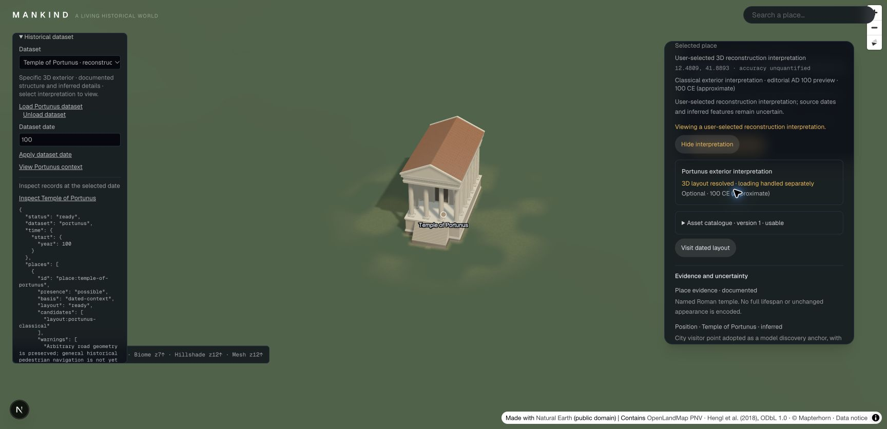

# Temple of Portunus — Phase 4 Step 8

The first catalogue-backed historical building is a visible, project-authored
exterior interpretation of the Temple of Portunus in Rome. It uses a specific
building model, with its evidence and inferred features attached to catalogue
version 1. It is not an archaeological survey or an expert-certified restoration.

## View it

1. Open **Historical dataset**, select **Temple of Portunus · reconstruction interpretation**, and load the dataset.
2. Choose **View Portunus context** to select the editorial AD 100 preview.
3. Choose **Inspect Temple of Portunus**, then **Show reconstruction interpretation**.
4. Expand **Asset catalogue · version 1 · usable** to inspect sources, feature certainty, limitations, rights and the pinned model checksum.

The default is geographic context. Showing this interpretation is an explicit
choice; approximate dates remain approximate. **Hide interpretation**, a date
change, dataset replacement or unloading revokes that choice. AD 99/101 have no
model. AD 100 is an editorial preview context, not an attested construction date
or a claim that every rendered feature existed together in that year.

## Evidence and modelling decisions

| Source | What it supports | Limits |
| --- | --- | --- |
| [Fletcher 1921, p.105, Penn State Libraries / Allan Kohl record WB2007-0510](https://www.flickr.com/photos/psulibscollections/5832798550/) | Historic plan and front/side elevations; dimensional scaffold and column arrangement | An old published interpretation, not a modern measured survey; small drawing read manually |
| [Soprintendenza Speciale di Roma](https://soprintendenzaspecialeroma.it/luoghi/tempio-di-portunus/) | Named building, Ionic order, four frontal columns and Republican rebuilding context | Does not establish all rendered details or an exact AD 100 appearance |
| [Roma Capitale / Turismo Roma](https://www.turismoroma.it/en/places/temple-portunus) | High podium, steps, side columns and visitor location | Visitor point is an inferred discovery anchor, not a surveyed footprint |

The plan's printed dimensions were manually transcribed: length 70 ft, cella
width 30 ft 4 in, column height 27 ft, podium 9 ft 11 in, eaves 43 ft 7 in and
roof rise 8 ft 7 in. Unit conversion uses 0.3048 m/ft. These are inputs to the
interpretation, not claims of present-day measurement accuracy. Proportions,
wall thickness, stair divisions, simplified Ionic volutes, fluting, dentils,
roof tile spacing and uniform finishes involve inference. The generator and
`parameters.json` identify these decisions. Colour is not a claim about ancient
paint or weathering. The north-facing pose is an unmeasured display inference.

The model includes a podium, entrance stairs, cella exterior, free/engaged
columns, entablature, pediments and a tiled roof. No interior, furnishings,
sculpture, population or surrounding ancient neighbourhood is reconstructed.

## Reproducible asset and provenance

- Generator: `scripts/reconstructions/portunus/generate.py`, run with Blender 5.2.4 via `blender --background --factory-startup --python scripts/reconstructions/portunus/generate.py`.
- Model: `public/assets/reconstructions/portunus/portunus-v1.glb`; 3,261,376 bytes, five meshes/material groups, 84,294 triangles, no external textures or animation.
- Prepared dimensions: 11.426936 × 16.093063 × 21.553000 m (width × height × depth). Numerical precision describes the generated mesh, not historical certainty.
- SHA-256: `b45e24935e14af4227b6561b221f92a70312900accc251f008db5e537b547f35`.
- Drawing copy and pinned hash: `data/history/portunus/source/manifest.json`.
- Exact catalogue pin: `catalogue:portunus-exterior@1`, registry `portunus-exterior-v1`.

The mesh was authored here; no third-party mesh or image pixels were imported.
The library record explicitly describes the historic illustration as public
domain; the source page also carries platform rights metadata. The local
[provenance declaration](../public/assets/reconstructions/portunus/PROVENANCE.md)
records the basis used. Existing repository terms apply to the authored model;
this change grants no new public licence. Catalogue rights can now point to a
validated local provenance Markdown file as well as a public terms URL.

`prepare-data.mjs` reproduces the dataset, ingest metadata and manifest from the
model and source files. The catalogue add/review commands preserve the immutable
content version and append its technical/source review. The reviewer is recorded
as Codex; usable means usable as this labelled interpretation, not independently
verified archaeology.

## Runtime and acceptance

An explicit preview resolves only the requested layout and its pinned usable
asset. Draft/retired assets, missing models, wrong places/categories, unknown
geometry, unsupported layouts and mandatory missing scene requirements still
block rendering. Strict automatic selection is unchanged. The current renderer
preserves authored model materials for historical definitions and uses the
existing GLB cache, terrain placement, shadows and cleanup lifecycle. Regional
LOD still uses the existing coarse building proxy; column detail appears in the
local model.

`node scripts/check-portunus-reconstruction.mjs` exercises pinned source/model
bytes, actual GLB loading and triangle count, strict versus explicit selection,
date/status/evidence guards, session revocation, actual scene placement, material
preservation and lease disposal. The full gate is
`node scripts/check-phase3.mjs docs/previews/portunus/validation`; its machine-readable
report is stored in that directory. All 27 commands passed on 2026-10-30, including
typecheck, lint and the production webpack build. Browser checks confirmed the
visible model and authored finishes, catalogue sources/rights, hide removing its
descriptor and cache lease, and date changes revoking the interpretation.

Browser evidence also includes `03-hidden.jpg`, `04-date-change.jpg` and
`05-catalogue.jpg` in `docs/previews/portunus/`. The separate model render is
`01-model-render.png`. These verify the authored interpretation and runtime
integration; they do not establish historical accuracy.

Step 9 is the sourced journey using this catalogue pin and explicit interpretation,
with interruption, exploration/resumption and missing-content handling. Automatic
AI research/acquisition remains Phase 5.
