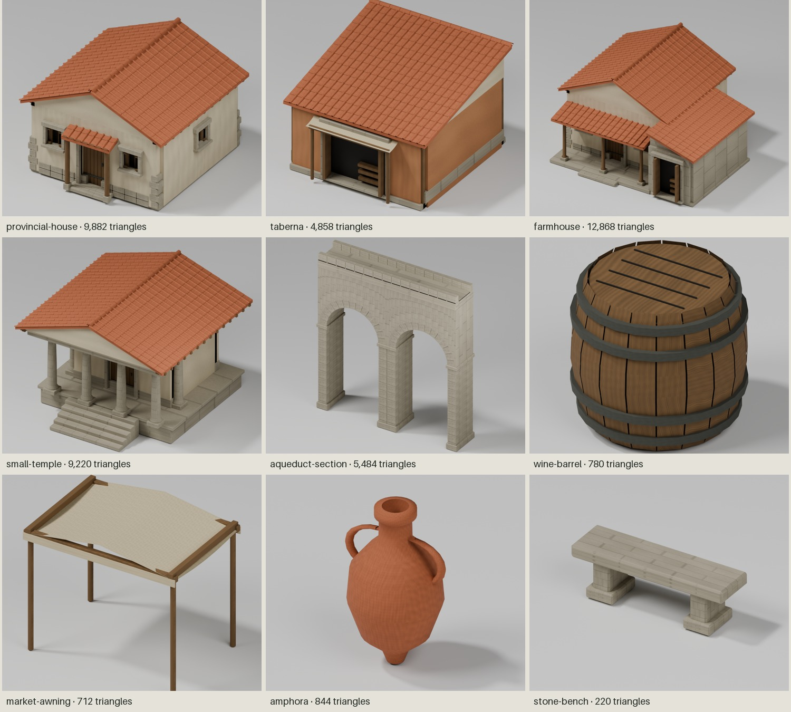

# Project-owned Roman architecture kit — 28 October 2026

**Phase 1 update:** twelve seeded residential/commercial variants are now integrated.
See [Roman building variations](roman-variations.md) for current inventory,
shared-library loading, instancing, validation, previews and performance comparisons.
The original migration report and nine-asset baseline below are retained for reference.

The Roman Town Pack dependency has been replaced by nine project-authored Blender
GLBs: three different dwelling/shop archetypes, a temple, an extendable aqueduct
section and four props. Twelve separate module GLBs supply reusable authoring
parts. The existing nine environment GLBs are byte-for-byte unchanged.



## Generate and inspect

Blender is installed at `/Applications/Blender.app/Contents/MacOS/Blender`, version
5.2.4 LTS Release Candidate, hash `128c8c1f6a08`. Its sandboxed launch crashed
before Python initialization; the approved unsandboxed background process works.
No GUI automation is needed: Cycles renders two studio views per asset, with fixed
camera direction, ground, lighting, 32 samples and denoising. `.blend` scenes are
also saved for interactive inspection if desired. No plug-ins, paid tools, image
AI or external model-generation service are used.

```sh
# First house, reviewed before extending the kit:
/Applications/Blender.app/Contents/MacOS/Blender --background --factory-startup --python-exit-code 1 --python scripts/roman-kit/generate.py -- --only provincial-house --render --save-blend
# All nine complete assets:
/Applications/Blender.app/Contents/MacOS/Blender --background --factory-startup --python-exit-code 1 --python scripts/roman-kit/generate.py -- --render --save-blend
# Twelve reusable authoring modules:
/Applications/Blender.app/Contents/MacOS/Blender --background --factory-startup --python-exit-code 1 --python scripts/roman-kit/generate.py -- --modules
```

Run generation sequentially from the repository root. The generator updates named
files/manifest entries only. Source and data are in [the kit folder](../scripts/roman-kit/README.md):

- `generate.py`: Blender mesh primitives, bevels, wall bays, actual opening gaps,
  shutter/door assemblies, roof slopes/tiles, columns, arch voussoirs and props.
- `buildings.json`: archetypes, physical dimensions, roof/entrance choices and
  farmhouse composition. These are separate from the generation implementation.
- `modules.json`: 1m wall bays, 30cm wall thickness, limewash/stone/timber variants,
  corner masonry, door/window/workshop bays, tiled/simple roof bays, Tuscan column,
  threshold/foundation step and stone trim.
- `environment-baseline.json`: hashes of the nine environment meshes retained
  unchanged, checked on every kit validation run.

GLBs use metres, Y-up, ground Y=0, +Z entrance, scale 1. Python uses game XYZ and
converts once to Blender XYZ `(east, north, up)` before standard glTF export.
The existing `prepareAsset` still centres measured bounds in X/Z. No models are
stretched. The source generator never reads the removed pack or another library.
A repeat farmhouse generation from the separated composition data produced the
same SHA-256 before the subsequent mortar-core geometry refinement.

## Architecture and art review

The provincial house has limewash over a low masonry plinth, recessed front/rear
and side windows, thick stone surrounds, shutters, seven-board door, iron straps,
a shallow supported porch, overhanging eaves, rafter ends and a pitched tiled roof.

The taberna has an ochre plaster/timber facade, a 2.6m open workshop bay with folded
street shutters and an internal counter, a linen shelter, and a taller rear wall
supporting a single-slope roof. It is a different structure, not a resized house.

The farmhouse has a larger L plan: raised main dwelling, lower stone service wing,
broad barn/work bay and roofed veranda. Its lower roofs sit below the main eaves.
An initial overlapping roof junction was rejected during render review and rebuilt.

The temple has a low podium, five frontal steps, four front Tuscan columns plus
two side supports, cella, architrave, cornice and a restrained pediment. No fantasy
ornament or unsupported canopy was added. A cornice that penetrated roof corners
was removed following render review.

The aqueduct has two real open arches, radial voussoirs, masonry piers/spandrels,
a coping and a dry open water trough. It repeats every 8m in X; end half-piers
combine into full piers. Small plinth/coping overlaps are intentional. Initial
coplanar spandrels were rejected and matched to the outer arch segments instead.
A raycast later exposed joints through a pier: recessed mortar cores now close
structural joints while preserving the bevelled stone relief.

Props preserve the same roles: convex stave barrel with iron hoops, sagged linen
awning on timber supports, shouldered amphora with paired handles/open neck, and
bevelled stone bench. They are generated from original project geometry.

The atlas has eight padded material cells: lime plaster, stone, fired terracotta,
timber, recess, iron, linen and ochre plaster. Deterministic generated base colour
and tangent normals supply mineral grain, mortar, firing variation, wood grain,
cloth weave and restrained weathering. Standard texture/Normal Map/Principled
nodes export real glTF maps; Blender procedural nodes are not left unbaked in a
browser-incompatible material. The atlas material is double-sided for thin roof
cover tiles and cloth; opaque geometry still occupies one draw batch per asset.

General architectural references are the [Pompeii Archaeological Park guide](https://pompeiisites.org/wp-content/uploads/A-Guide-to-the-Pompeii-Excavations-2.pdf)
and its [building catalogue](https://pompeiisites.org/en/houses/). These inform a
modest house/shop vocabulary, not a reconstruction of a named site. No reference
imagery is included in the assets. The material export follows the
[Blender glTF material documentation](https://docs.blender.org/manual/en/dev/addons/scene_gltf2.html).

## Integration and lifecycle

Logical villa/temple/aqueduct/prop IDs are preserved; their registry paths now point
to `roman-kit/`. Two IDs were added for taberna/farmhouse. The seven original
building placements/headings are retained: three houses, one taberna, one farmhouse,
one temple and one aqueduct. No scenery placements were added or moved.

Only six approach endpoints were adjusted by 0.1–0.4m for the new measured
footprints. The farmhouse has its own correctly sized plot/foundation; it is not
squeezed into the former villa dimensions. Existing footprint sampling, slope
rejection, relocation, exaggerated elevation, paths and geographic anchors remain.

The GLB cache and reference-counted lease architecture are unchanged. Repeated
houses share geometry/materials/maps through the cache. Complete buildings merge
all components to one material batch at export; scenery still uses InstancedMesh.
The twelve `module-*` GLBs are not registered or fetched by gameplay.

Source materials remain immutable. Settlement copies keep the existing back-face
shadow setting and slight deterministic per-building tint; textured kit materials
bypass the former prototype roof/plaster shader. The pack-specific awning tint is
removed. Shared atlas textures are disposed by the cache only after the last user
releases its lease. Tests explicitly check that releasing one user preserves maps
for another, and that last-user release disposes each map once.

The old original/enhanced selector and its runtime factory import were retired.
`enhancedVilla.ts` is retained only as an unimported project-owned experiment;
historical screenshots/report remain available. There is no visual-skin system.

## Asset metrics

Each runtime asset has **one material/mesh batch** and two embedded PNGs, each
512×256 (base colour + normal). No decoder extension or additional runtime
package is needed. Exact raw bounds, hashes and counts are in
[manifest.json](../public/assets/roman-kit/manifest.json).

| Asset | Bytes | Triangles | X × Y × Z (m) |
| --- | ---: | ---: | --- |
| `provincial-house.glb` | 1,025,268 | 9,882 | 5.989 × 4.330 × 6.352 |
| `taberna.glb` | 647,948 | 4,858 | 6.039 × 4.160 × 6.425 |
| `farmhouse.glb` | 1,237,172 | 12,868 | 8.191 × 4.750 × 7.395 |
| `small-temple.glb` | 956,516 | 9,220 | 7.480 × 5.610 × 7.600 |
| `aqueduct-section.glb` | 713,948 | 5,484 | 8.130 × 8.793 × 1.720 |
| `wine-barrel.glb` | 348,172 | 780 | 0.900 × 0.800 × 0.897 |
| `market-awning.glb` | 351,220 | 712 | 2.600 × 2.180 × 1.818 |
| `amphora.glb` | 358,004 | 844 | 0.662 × 1.000 × 0.550 |
| `stone-bench.glb` | 318,280 | 220 | 1.800 × 0.580 × 0.500 |


The old seven GLBs totalled 117,372 bytes, with no textures. The new runtime set
adds genuine geometry and PBR maps, so download size rises substantially in relative
terms. Absolute transfer is approximately 5.96 MB for all nine unique assets;
initial globe navigation still does not load them. All registered assets including
the unchanged environment total approximately 8.35 MB. Authoring modules add about
3.9 MB on disk and are not downloaded by the settlement.

An atlas pair is about 1.33 MiB of RGBA8 GPU texture storage including mipmaps.
It is shared between repeated instances of one asset. Separate GLB URLs currently
embed separate copies, so nine unique kit assets can use about 12 MiB for maps.
Cross-GLB atlas interning is a possible later optimization, not hidden in this pass.
Temporary authoring geometry is merged offline; there are no individually drawn
tiles or runtime roof-generation allocations.

The previous enhanced-villa settlement had about 61 regular colour batches
(31 building primitives, 20 scenery batches, 10 road/foundation/ground draws).
The new settlement has **33**, confirmed by the live renderer: seven building
batches, 16 scenery batches and ten existing surface draws. Shadow refreshes add
caster draws; they remain invalidation-driven, not perpetual. Geometry increases
substantially from the 80-triangle prototype villas; the new complete houses are
under 13k triangles each. The supplied simple roof module can support later LOD
authoring; a runtime LOD pipeline was not necessary for this seven-building scene.

A desktop development-build sample at 3456×1786, zoom 18.9, pitch 55°, rotating
bearing −25°→0° over 2.4s collected 253 render events: **8.9 ms median / 12.1 ms p95**,
33 median draws and 567,406 median submitted triangles. This is a short render-event interval sample, not GPU timing, a mobile
benchmark or a controlled before/after regression measurement. The earlier
informal environment sample was 8.6 / 12.7 ms; they indicate similar desktop
responsiveness but do not establish cross-device equivalence.

## Visual evidence

The tracked contact sheet above is assembled from the actual Blender renders.
Raw front/rear PNGs and optional `.blend` scenes for each of the nine models are
under `.biome-data/review/roman-kit/`. They are local ignored review artifacts,
reproducible through the commands above.

Actual shared MapLibre/Three canvas captures (no generated art):

- `house-in-game.png`: final house, centre [12.5498915,41.85006295], zoom 21,
  pitch 55°, bearing −60°, matched to the prior original/enhanced villa cameras.
- `settlement-in-game.png`: centre [12.55,41.85], zoom 18.9, pitch 55°, bearing
  −25°, matched to the previous settlement review.
- `farmhouse-in-game.png`: centre [12.5498553,41.8499101], zoom 20.8, pitch 55°,
  bearing 150°, showing veranda, wing, workshop, temple and props together.
- `first-house-in-game.png`: the first incremental integration, before the other
  pack assets were replaced.
- `performance.json`: the measured desktop sample.

All PNGs use the original settlement origin, 1× exaggeration, unchanged fixed
lighting and 3456×1786 canvas. The historical pack baseline and enhanced-villa
screenshots remain under `.biome-data/review/phase3-villa/`.
`scripts/capture-villa.js` reproduces matched house/settlement captures.

Compared with the pack, windows and entrances now have visible depth, eaves are
supported and roofs have material/edge structure. Compared with the earlier
procedural villa, the new GLB adds side windows, a supported porch, a portable
textured material and offline authoring. At gameplay distance the three roof/plan
silhouettes, plinths and window shadows remain distinguishable. Small hinges and
material grain appropriately disappear at that distance.

The result is a coherent, reusable first Roman kit and a noticeable step toward
the requested Civilization-inspired aesthetic. It is **not equivalent to a
finished Civilization art set**. Remaining limits: regular repeated plaster
weathering, visible atlas repetition on long surfaces, restrained stone colour
variation, no baked building AO, no occupied interiors, no full-building LODs,
coarse existing DEM/contact shadow and foundation slabs. Richer roof plans,
carefully authored weathering and selective asymmetry are the next art improvements;
more scenery or rendering infrastructure is not required to pursue them.

## Controlled removal and provenance

The first house was rendered and inspected, integrated at `villa-west-2`, and
captured in-game before the other archetypes were generated. Workshop/farmhouse
renders were then inspected; their silhouettes and roof junction were reviewed.
Temple/aqueduct and props followed, with the geometry corrections noted above.
The complete replacement set passed asset/settlement checks and browser loading,
relocation and exaggeration before the old files were removed.

Removed: the seven GLBs in `public/assets/roman/` and its public `LICENSE.txt`.
No active runtime, debug tool, asset check or generator loads those paths or the
old archive. The old attribution and exact licence text are preserved in the
historical [asset report](roman-assets.md), [licence archive](archive/roman-town-pack-LICENSE.txt)
and [original file metrics](archive/roman-town-pack-metrics.json). These historical
terms do not apply to the newly authored assets. The pack was not used to train
anything, and its meshes/textures were not converted into this kit.

## Validation

Passed after migration:

- `pnpm typecheck`
- `pnpm lint`
- `pnpm exec next build --webpack`
- `node scripts/check-roman-kit.mjs`
- `node scripts/check-settlement.mjs` (also runs real GLB/cache asset checks)
- `node scripts/check-geography.mjs`
- `node scripts/check-hillshade.mjs`
- `node scripts/check-biomes.mjs`
- `git diff --check`

Kit checks parse all 21 GLBs with the installed GLTFLoader, verify exact bytes and
hashes, Y=0 raw floors, physical bounds, finite attributes, one batch/model,
triangle budgets, embedded PNG payloads/dimensions, UV ranges, material colour
spaces and decoder independence. Raycasts verify +Z recessed doors/workshop bay,
open arches, solid central pier and open trough. They also enforce three distinct
residential archetypes, absence of the old public directory/active path references
and unchanged environment hashes. The test-only Node bitmap adapter validates
embedded PNG headers/compressed payloads and dimensions; real texture decoding
and shading are checked in Blender and Chrome, not claimed from the Node shim.

Existing settlement tests still cover actual placements, road unions and footprint
clearance, level/sloped foundations, confirmed/uncertain DEM, retained heights,
relocation, steep sites, stale async results, failures/retry and cleanup. Atlas
last-user disposal checks were added to the cache test. Renderer/anchor logic was
not rewritten.

Live Chrome reached 7/7 ready and 508/508 scenery, moved the camera between close
and elevated views, relocated to [12.5515,41.851] and back, changed exaggeration
1×→2.5×→1×, unloaded to 0/7 and reloaded to 7/7. The independent Giza test fixture
loaded 3/3 new models and globe navigation returned to the settlement. Two low-zoom
Mapterhorn DEM requests returned pre-existing 404s during travel; the settlement
site subsequently loaded confirmed terrain. Desktop-only browser review.

## Files

Created: `scripts/roman-kit/` source/data/readme/baseline, `scripts/check-roman-kit.mjs`,
`scripts/glb-node-images.mjs`, `public/assets/roman-kit/` (21 GLBs, two atlas PNGs,
manifest and provenance), this report, tracked preview sheet and historical archive.

Changed: registry, settlement archetype choices/approach endpoints, textured-material
handling, scene/debug wiring to retire the old experiment, instanced scenery to
remove the pack-specific cloth override, capture helper and asset/settlement tests.
Historical milestone reports and environment provenance now identify the migration.
No environment GLB, MapLibre renderer, geographic anchor, terrain pipeline, package
manifest or dependencies changed in this pass. Pre-existing staged work was preserved.
