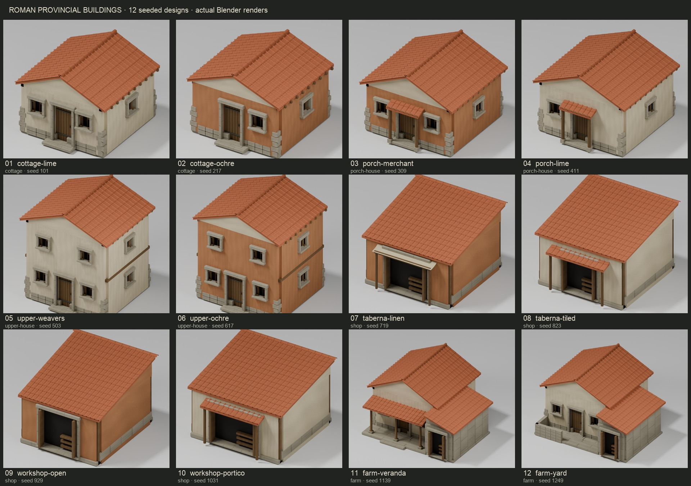

# Roman building variations — Phase 1

Twelve project-authored residential/commercial designs extend the existing Blender kit.
The nine original Roman GLBs, twelve authoring modules, temple, aqueduct, props and
nine environment GLBs remain intact. No terrain, geography, biome or historical data
changed. No runtime mesh assembly, external assets, new dependencies or services.



## Architecture and deterministic generation

The original kit already parameterised dimensions, pitch/eaves, door width, porch,
and a constrained L-plan farmhouse. Window positions and vertical wall infill assumed
one storey; shop shelters, facade materials and farmhouse veranda were fixed. This
extension reuses its wall/opening/roof/stone/timber builders and export path, adding
stacked aperture infill, explicit facade layouts, modest upper storeys, material
choices, supported shelter choices and a veranda/workyard option.

`variations.json` separates architectural profiles, bounded ranges, explicit choices,
weights and seeds from `variations.py` resolution/validation and Blender geometry.
Named SHA-256 samples combine global seed 271828, design name, design seed and
parameter name. Dimensions resolve to centimetres. Added parameters do not change
existing samples. `--seed N` intentionally overrides per-design seeds for a new
library revision. Stable per-cell vertex pigments vary plaster, clay, timber and
stone; lower-wall vertex stains supplement the unchanged atlas wear pattern.

Rules reject extreme dimensions/aspect ratios, unsupported eaves/pitch/shelters,
misaligned storeys/porches, intersecting aperture surrounds, openings too close to
corners/eaves and unsupported farmhouse junction changes. The farmhouse's validated
wing coordinates remain fixed. These rules constrain supported compositions; they
are not a general mesh collision solver. Visual review remains necessary for new
profiles. There are no complex interiors.

The library keeps actual tiled roofs with two cover-tile segments instead of four.
Vertex pigment uses one exported colour channel. Every building remains one indexed
mesh, with one shared PBR material, one 512×256 base map and one 512×256 normal map
for the entire library; no decoder extensions. PNG payloads are embedded once.

```sh
/Applications/Blender.app/Contents/MacOS/Blender --background --factory-startup --python-exit-code 1 --python scripts/roman-kit/generate.py -- --variants --render --save-blend
# Same library, no renders:
/Applications/Blender.app/Contents/MacOS/Blender --background --factory-startup --python-exit-code 1 --python scripts/roman-kit/generate.py -- --variants
python3 scripts/roman-kit/check_variations.py
node scripts/check-roman-variations.mjs
.biome-venv/bin/python scripts/roman-kit/contact_sheet.py
```

Blender 5.2.4 LTS RC hash `128c8c1f6a08`, bundled Python/NumPy/exporter. Reproducibility
is scoped to this pinned toolchain. `--render-only NAME ...` with `--variants --render`
limits studio previews while exporting the complete library. Run generators sequentially.
Studio PNGs and optional source `.blend` remain under `.biome-data/review/roman-kit/`.

## Inventory

All names below are nodes in `public/assets/roman-kit/residential-variants.glb`;
registry IDs prefix each name with `roman-`. Exact parameters/bounds are in
[`variants.json`](../public/assets/roman-kit/variants.json).

| Variant | Seed | Triangles | Width × height × depth (m) | Distinction |
| --- | ---: | ---: | --- | --- |
| `cottage-lime` | 101 | 7,416 | 5.31 × 4.04 × 5.52 | Compact limewash cottage, two street windows |
| `cottage-ochre` | 217 | 7,334 | 5.42 × 4.01 × 5.42 | Ochre cottage, offset door and one street window |
| `porch-merchant` | 309 | 8,438 | 5.90 × 4.36 × 6.06 | Ochre dwelling with supported tiled porch |
| `porch-lime` | 411 | 8,172 | 5.89 × 4.43 × 6.13 | Lime dwelling with asymmetric front and porch |
| `upper-weavers` | 503 | 10,272 | 5.91 × 6.48 × 5.54 | Two-storey lime dwelling, upper and side windows |
| `upper-ochre` | 617 | 10,260 | 5.92 × 6.35 × 5.55 | Two-storey ochre dwelling, offset door |
| `taberna-linen` | 719 | 3,706 | 5.50 × 3.82 × 5.87 | Open taberna with linen street shelter |
| `taberna-tiled` | 823 | 3,692 | 5.64 × 4.04 × 6.01 | Lime taberna with supported tiled shelter |
| `workshop-open` | 929 | 3,446 | 5.04 × 3.92 × 5.83 | Uncovered ochre work bay |
| `workshop-portico` | 1031 | 3,732 | 5.86 × 3.88 × 5.96 | Lime workshop with broad opening and tiled portico |
| `farm-veranda` | 1139 | 10,904 | 8.19 × 4.89 × 7.39 | L-plan dwelling, stone service wing and veranda |
| `farm-yard` | 1249 | 11,016 | 8.19 × 4.85 × 7.35 | L-plan farm, open workyard and low boundary |

## Settlement integration

`createRomanSettlement(seed = 20261028)` selects house/workshop/farmhouse roles using
weighted sampling without replacement within each archetype cycle. Six house choices
therefore appear before a house repeats; weights favour ordinary cottages/porch houses
and the linen shop. Seed, authored plot order and role define selection; terrain,
camera, async loading and geographic relocation do not. Existing seven plot offsets,
headings, road endpoints, landmarks and scenery remain unchanged.

The ordinary registry adds a `nodeName` selector. `prepareAsset` detaches that complete
prebuilt node from a cache lease and uses the existing measured-bounds centring and
terrain foundation path. All variant IDs use one GLB URL: one cache request serves
any number of instances. No per-building inventory/texture request is added. One
settlement shadow override material is shared across all library nodes; variation
is baked into vertex attributes rather than allocated as per-instance materials.

Repeated library geometry uses `InstancedMesh` within the existing `SettlementScene`.
Logical building roots still own terrain visibility/heights, roads and foundation
state. Batches update only when terrain is invalidated; missing/steep sites are
omitted, relocation hides them immediately, and unload disposes instance buffers
while the cache retains source ownership. Unique variants remain one draw each.
Foundations and surfaces retain their existing rendering behaviour. This is a small
batching extension, not a renderer rewrite or a 500-building performance claim.

The separate `ROMAN_VARIATION_PREVIEW` fixture shows all twelve designs plus three
repeated instances using the same loader, terrain placement and shadows. Its streets
and orderly review plots are for comparison, not an expanded historical town layout.
Paste `scripts/capture-roman-variants.js` into the development console, then use
`romanReview.fixture(true)`, `romanReview.fixture(false)` (normal settlement), or
`romanReview.fixture('baseline')` (original assets in the normal plots).

The supported parameter ranges (metres) are:

| Profile | Width | Depth | Wall height | Roof rise | Overhang |
| --- | --- | --- | --- | --- | --- |
| Cottage | 4.4–4.7 | 4.2–4.6 | 2.65–2.8 | 1.0–1.15 | .23–.30 |
| Porch house | 4.9–5.2 | 4.8–5.15 | 2.8–3.05 | 1.15–1.45 | .28–.35 |
| Upper house | 4.9–5.2 | 4.3–4.65 | 5.05–5.25 | 1.05–1.25 | .25–.33 |
| Shop | 4.4–5.3 | 4.3–5.2 | 2.75–3.15 | .65–1.05 | .22–.30 |
| Farm | 7.4 fixed | 6.5 fixed | 3.2–3.3 | 1.15–1.5 | .35 fixed |

Shop openings range from 2.1–2.8m, with an explicit 2.9m broad workshop choice.
House layouts control `doorX`, `frontWindows`, `storeys`, `porch` and `wallMaterial`;
shops add `shelter`; farms add `verandaRoof` and `boundary`. Pigment ranges and the
0.8m/9% foundation stain live in the same variation data. Farm heights are bounded
so even the lowest main roof clears the wing cover tiles at the supported junction.

## Measurements and trade-offs

The normal seven-building fixture was compared with its original assets at identical
plot offsets/headings, 508 scenery instances, confirmed terrain, physical 1× elevation,
fixed lighting, Chrome development build and 3456×1786 canvas. Camera: centre
[12.55,41.85], zoom 18.9, pitch 55°, bearing −25°→0° over 2400ms. Six alternating
samples used 5s of warm-up each; every sampled frame had the tab visible. Blender,
builds and checks had finished. These are **render-event intervals**, not GPU timing,
load-time measurements, a mobile benchmark or a controlled hardware laboratory.

| Metric | Original | Variants |
| --- | ---: | ---: |
| Ordinary designs available (including retained originals) | 3 | 15 |
| Original Roman GLBs retained | 9 / 5,956,528 B | 9 / 5,956,528 B |
| New twelve-design library | — | 8,012,236 B |
| Whole Roman catalogue, including retained assets | 5,956,528 B | 13,968,764 B |
| Unique Roman bytes needed by normal settlement | 5,956,528 B | 11,058,376 B |
| Median regular draw calls | 33 | 33 |
| Median submitted triangles | 567,406 | 558,666 |
| Renderer resident geometries | 33 | 35 |
| Renderer resident textures | 23 | 19 |
| Final pooled render intervals, median / p95 | 8.4 / 10.2 ms | 8.4 / 10.5 ms |
| Final sampled intervals | 859 | 853 |

The user's earlier reported baseline was 8.9 / 12.1ms, 33 draws, 5.96MB. The final
matched comparison is more useful than claiming improvement against that earlier
sample. Its p95 rises 0.3ms (2.9%), while medians are identical. Individual final
samples ranged 9.4–10.6ms p95 before and 9.5–11.1ms after. An earlier alternating
three-sample set slightly favoured the variants (before p95 9.8–10.8ms, after
9.5–10.5ms). Investigating both sets found no consistent frame-time regression;
these short desktop samples cannot establish equivalence on other hardware.
Shadow refreshes add caster draws and remain invalidation-driven.

The raw first-settlement download does increase by 5.10MB (85.7%): the shared library
loads all twelve designs together. This cost is explicit, not hidden by the stable
frame times. It avoids repeated atlas payloads/decodes and per-instance requests,
and amortises across settlements while leased. Roof simplification and removing an
unused colour channel reduced the initial library export from 10.18MB to 8.01MB.
Future selective loading or standard transport compression is worth evaluating if
first-load bandwidth becomes a bottleneck. No decoder package was added here.
Repeated nodes share geometry/materials/maps; existing foundations still draw per
plot. There is no claim that adding hundreds of foundations is free.

Tracked [measurement summary](previews/roman-variants-performance.json) contains all
six trial summaries. Raw per-frame rows, the earlier comparison, generation logs,
determinism snapshots and check logs are in `.biome-data/review/roman-variants/`.

## Visual evidence and validation

Actual Blender renders and shared MapLibre/Three canvas captures, with no generated
art or geometry compositing:

- [Overview sheet](previews/roman-variants-overview.jpg): twelve front studio renders.
- [Normal settlement](previews/roman-variants-settlement.jpg): original centre/camera,
  7/7 buildings and 508/508 scenery, with the new seeded asset choices.
- [Full library settlement preview](previews/roman-variants-library.jpg): all twelve
  designs plus three repeated instances, 15/15 ready, at the same 18.9/55°/−25° camera.
- [Close-up](previews/roman-variants-closeup.jpg): centre [12.54985,41.8499], zoom 21,
  pitch 55°, bearing −25°; farm veranda/workyard, house storeys and shop shelters.
- [Repeated-archetype comparison](previews/roman-variants-comparison.jpg): five house
  designs and workshop variants side by side, centre [12.55,41.85013], zoom 20.5,
  pitch 55°, bearing 0°. Full viewport guard excludes docked DevTools captures.

All tracked in-game captures derive from 3456×1786 PNGs, 1× elevation and existing
lighting. Original PNGs are retained in `.biome-data/review/roman-variants/`.
The review sheet can be rebuilt with the Pillow helper in the existing biome venv;
Pillow is not a runtime dependency. Raw front/rear studio PNGs and the source scene
are in `.biome-data/review/roman-kit/`.

Visual inspection covered studio front/rear views, the overview, the full-library
preview and close-up. The initial stacked-window wall overlap was corrected with
multi-height infill. Shop material choices now apply consistently across elevations.
Farm parameter ranges and junction checks keep the wing tiles below the main roof.
No floating supports or visible roof clashes remain in the reviewed designs.

Passed:

- `pnpm typecheck`
- `pnpm lint` (no warnings)
- `pnpm exec next build --webpack`
- `node scripts/check-roman-kit.mjs`
- `node scripts/check-roman-variations.mjs` (also runs the real asset/cache checks)
- `node scripts/check-settlement.mjs`
- `python3 scripts/roman-kit/check_variations.py`
- `node scripts/check-geography.mjs`
- `node scripts/check-hillshade.mjs`
- `node scripts/check-biomes.mjs`
- `git diff --check`

The new checks parse every library node, test finite geometry/UVs, dimensions, floor,
triangle budgets, real vertex pigments, one material/two textures, decoder independence,
solid wall bands between storeys, deterministic weighted selection, unchanged landmark
placements and original Roman hashes. The Python checks exercise 1200 seed/design
combinations plus invalid proportions, openings, roofs, storeys and wing configurations.
A second complete Blender export reproduced SHA-256
`68e515c627f7f02e6d852da40561fb73e376b7737b5191ab8f4ba62d34211e2e`, including after moving
pigment ranges into the data file.

Scene tests verify the 15-building review fixture uses one GLB request, repeated nodes
share three two-instance batches, instance matrices follow terrain, relocated batches
hide until terrain is confirmed, steep plots are omitted and unload cleans up. Existing
settlement checks retain roads, scenery clearance, foundations, async cancellation,
retained/uncertain DEM, retries and last-user resource disposal. Original nine Roman
and nine environment GLB hashes remain unchanged; authoring modules pass their original
manifest hashes.

Browser review confirmed 7/7 and 508/508 loading, navigation to Giza (3/3 original
models ready) and back, relocation to [12.5515,41.851] and back, actual map terrain
exaggeration 1×→2.5×→1×, unload to 0/7 and reload to 7/7, and 15/15 library preview.
Two pre-existing low-zoom Mapterhorn tiles (5/14/10 and 5/14/11) returned 404 during
travel; the settlement subsequently had confirmed terrain. No Roman asset request
failed. Browser validation was desktop Chrome only.

## Remaining limitations

The normal fixture still has five ordinary plots, so the separate preview is needed
to inspect the entire library together. Review plots are deliberately regular.
Only two-storey houses are supported; workshops and farm service wings stay single
storey. Farm junctions are constrained rather than freely composable. Duplicate
instances of a named design are intentionally identical; diversity comes from the
seeded library selection, not arbitrary runtime mutations.

Atlas wear repeats, stone/roof colour shifts are restrained, and no baked building
AO, interiors or full-building LODs were added. Existing crisp foundation slabs,
coarse DEM/contact and soft ground transitions remain apparent, especially in the
unfurnished review fixture. First-load bandwidth is larger despite fewer texture
allocations. Longer GPU/mobile and large-town profiling remain future work.

## Files added, modified and removed

Added (18):

- `docs/previews/roman-variants-closeup.jpg`
- `docs/previews/roman-variants-comparison.jpg`
- `docs/previews/roman-variants-library.jpg`
- `docs/previews/roman-variants-overview.jpg`
- `docs/previews/roman-variants-performance.json`
- `docs/previews/roman-variants-settlement.jpg`
- `docs/roman-variations.md`
- `lib/assets/romanVariants.ts`
- `map/settlements/romanVariation.ts`
- `public/assets/roman-kit/residential-variants.glb`
- `public/assets/roman-kit/variants.json`
- `scripts/capture-roman-variants.js`
- `scripts/check-roman-variations.mjs`
- `scripts/roman-kit/check_variations.py`
- `scripts/roman-kit/contact_sheet.py`
- `scripts/roman-kit/original-baseline.json`
- `scripts/roman-kit/variations.json`
- `scripts/roman-kit/variations.py`

Modified (12):

- `docs/roman-kit.md`
- `lib/assets/prepareAsset.ts`
- `lib/assets/registry.ts`
- `map/settlements/SettlementScene.ts`
- `map/settlements/romanSettlement.ts`
- `map/threeTestLayer.ts`
- `public/assets/roman-kit/PROVENANCE.md`
- `scripts/check-roman-assets.mjs`
- `scripts/check-roman-kit.mjs`
- `scripts/check-settlement.mjs`
- `scripts/roman-kit/README.md`
- `scripts/roman-kit/generate.py`

Removed: none. No original GLB or atlas PNG changed. No package/dependency, terrain, geography, hillshade, biome or historical-data file changed.
